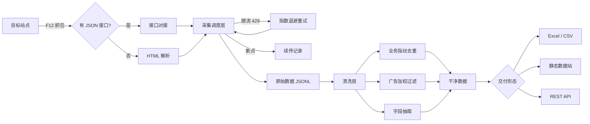

# 架构说明

## 整体流程



## 分层职责

### 采集层

| 模块 | 职责 | 关键实现 |
|---|---|---|
| 接口探测 | 判断数据来源 | F12 Network / 查看页面源码中的 fetch |
| 请求调度 | 控制并发与速率 | 线程池 + 每线程独立 keep-alive 连接 |
| 异常处理 | 区分「真到底」和「被限流」 | 状态码判断 + 指数退避 |
| 断点续传 | 中断后可继续 | 已采 ID 写盘，启动时加载 |

### 清洗层

| 模块 | 输入 | 输出 | 规则 |
|---|---|---|---|
| 去重 | 原始记录 | 唯一记录 | `(city, sorted(contact))` 作指纹 |
| 广告过滤 | 唯一记录 | 有效记录 | 强信号 +3、弱信号 +1，≥4 剔除 |
| 字段抽取 | 有效记录 | 结构化记录 | 正则优先级匹配，20+ 条规则 |

### 交付层

| 形态 | 适用 | 实现 |
|---|---|---|
| Excel/CSV | 客户要自己看 | openpyxl / csv（UTF-8-BOM 防乱码） |
| 静态站 | 要能筛选检索 | 原生 JS + 分片加载 + CDN |
| API | 要接进自有系统 | FastAPI + 缓存 + 限流 |

## 数据流体积控制

以 1 万条记录为例：

```
原始 JSONL          ≈ 20 MB
gzip 压缩后          ≈ 4.5 MB   (-77%)
按区域分片（3 片）    ≈ 1.5 MB/片
首屏只加载 1 片       ≈ 1.5 MB
浏览器解压后         = 完整可用
```

关键：`DecompressionStream` 在浏览器端解压，传输体积省 4 倍，解析在 Worker 里做，不阻塞渲染。

## 稳定性设计

| 风险 | 应对 |
|---|---|
| 请求被限流 | 429/403 指数退避，间隔 0.75s/页 |
| 连接被重置 | 每线程独立连接，异常时重建 |
| 页面改版 | 接口优先策略，改版影响小 |
| 采集中断 | 已采 ID 落盘，重启续传 |
| 数据源消失 | 多源冗余，任一源失效不影响整体 |
